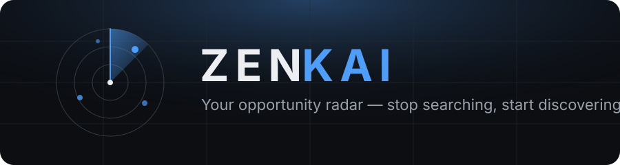
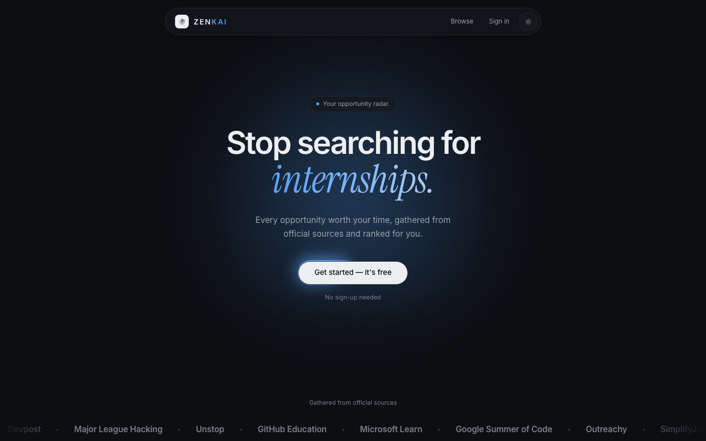
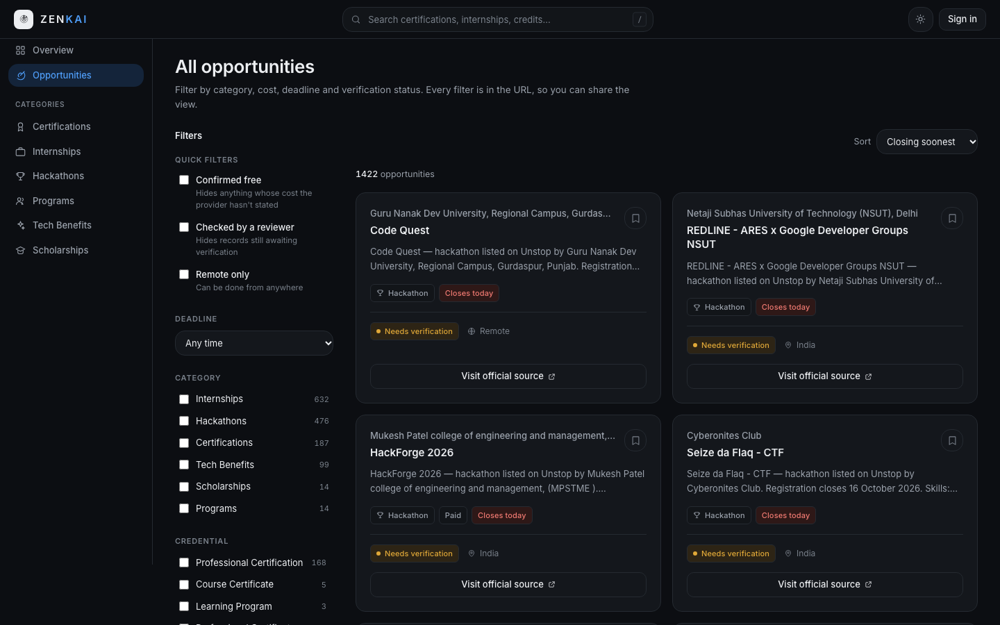

# Zenkai



As a student, the good stuff is scattered everywhere. Hackathons are on Devpost and MLH, internships on Unstop and SimplifyJobs, certifications on Microsoft Learn, free tools in the GitHub Student Pack, scholarships somewhere else again. I kept finding out about things after the deadline had passed, just because I didn't check the right site that week.

So I built Zenkai. It checks those sites every 6 hours and puts everything into one feed: internships, hackathons, competitions, certifications, scholarships, programs and free student tech.

Live: **https://getzenkai.vercel.app**

[](https://github.com/ganesh-tadigadapa/Zenkai/actions/workflows/ci.yml)



## What it does

- Pulls listings from Devpost, MLH, Unstop, SimplifyJobs, Microsoft Learn (certifications and Applied Skills), the GitHub Student Pack, Outreachy, Google Summer of Code, Opportunity Desk and a few RSS feeds, plus two community-maintained GitHub lists (free certifications and student discounts)
- Merges duplicates when the same thing shows up on two sites, and filters out posts that aren't actually opportunities
- Updates a listing when its deadline changes, and drops it once the deadline passes or the source removes it
- Lets you search and filter by category, cost, deadline and remote, then sends you to the official page to apply
- If you add your degree, skills and interests, every listing gets a 0-100 match score with the reasons behind it
- Saved list, a deadlines page (today / this week / later) and a personal overview page

You don't need an account to browse. "Get started" drops you into a guest account with no email or password, and you can attach an email and password later from the Profile page if you want to keep it. A guest account only lives in the browser that created it, so if you sign out before saving it, it's gone.



A couple of things I cared about:

- **Being honest about the data.** Every listing shows where it came from. Deadlines and costs only appear when the source actually states them. Anything from a non-official source (like the community lists) is marked "Needs verification". Still, always double-check on the official site before applying.
- **Being polite to the sites.** The fetcher reads robots.txt before touching a host and skips sources that don't allow it, rate-limits each site, and retries once on network errors.
- **Auth done properly.** Passwords are hashed with Argon2id. Sessions are random tokens in an httpOnly cookie, and the database only stores a hash of each token, so signing out revokes it immediately. Changing your password signs out every other device.

## How it works

```
sources --(every 6h)--> fetch --> clean up + dedupe --> database --> match score --> website
                                                          ^   |
                                                          +---+  update changes, close expired
```

The 6-hour fetch runs as a GitHub Actions cron job (`.github/workflows/discovery.yml`), since Render's free plan has no cron. Another workflow pings the API every 10 minutes so it doesn't fall asleep.

Hosting is all free tiers: the site on Vercel, the API on Render, the database on Neon PostgreSQL.

## Running it

You need Python 3.11+ and Node 20+.

```bash
make install    # backend venv + frontend npm install
make seed       # create tables and load starting data
make backend    # API on :8000 (auto-reloads), keep this running
make frontend   # in a second terminal, site on http://localhost:3000
make discover   # optional: run one live fetch right now
```

API docs are at http://localhost:8000/docs. Settings go in `backend/.env` and `frontend/.env.local`; copy them from `.env.example`. Locally it uses SQLite by default, or `make db-up` starts PostgreSQL in Docker.

If you run uvicorn yourself instead of `make backend`, add `--reload`, otherwise new routes stay missing until a restart and things like "Get started" fail with a 404.

```bash
make test    # backend tests (pytest, 387 right now)
make lint    # frontend type check + eslint
```

Both run on every push in CI.

## How it's put together

```
frontend/src/
  app/          pages: landing, opportunities, dashboard, profile...
  components/   cards, filters, layout
  lib/          API client, server actions, auth helpers
backend/app/
  api/          routes
  ingestion/    fetching, cleaning, dedupe, keeping things fresh
  models/       database tables
  services/     matching, deadlines, accounts
  seed/         starting data and the list of sources
backend/scripts/run_discovery.py   one fetch cycle
.github/workflows/                 tests, 6-hour fetch, keep-awake ping
```

More detail in [docs/](docs/): [architecture](docs/ARCHITECTURE.md), [database](docs/DATABASE.md), [development](docs/DEVELOPMENT.md) and [deployment](docs/DEPLOYMENT.md).

## Things I'd like to add

- Password reset by email
- Sign in with Google or GitHub
- Email alerts for new matches and closing deadlines
- More scholarship sources

## Built with

Next.js 16, React 19, TypeScript, Tailwind CSS v4 on the frontend. Python 3.11, FastAPI, SQLAlchemy 2, Pydantic v2, PostgreSQL and httpx on the backend.

## License

MIT, see [LICENSE](LICENSE). The listings themselves belong to their original sources and are under their terms.
