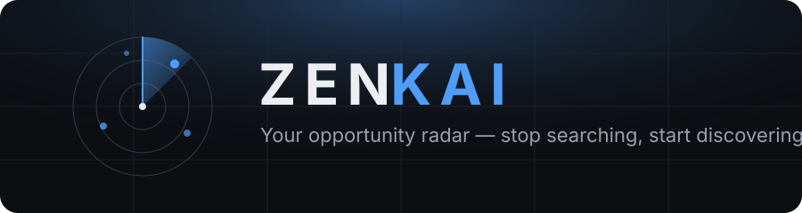
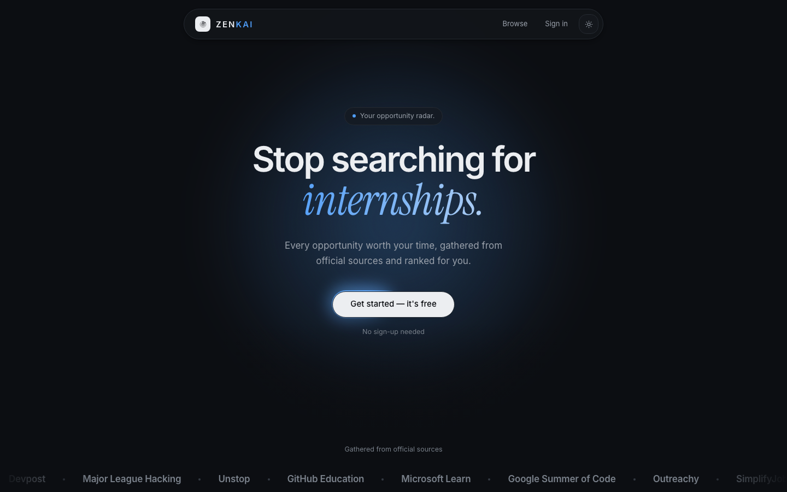
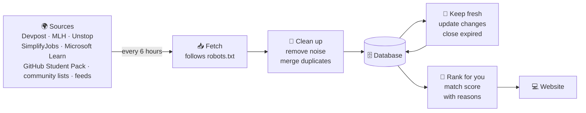
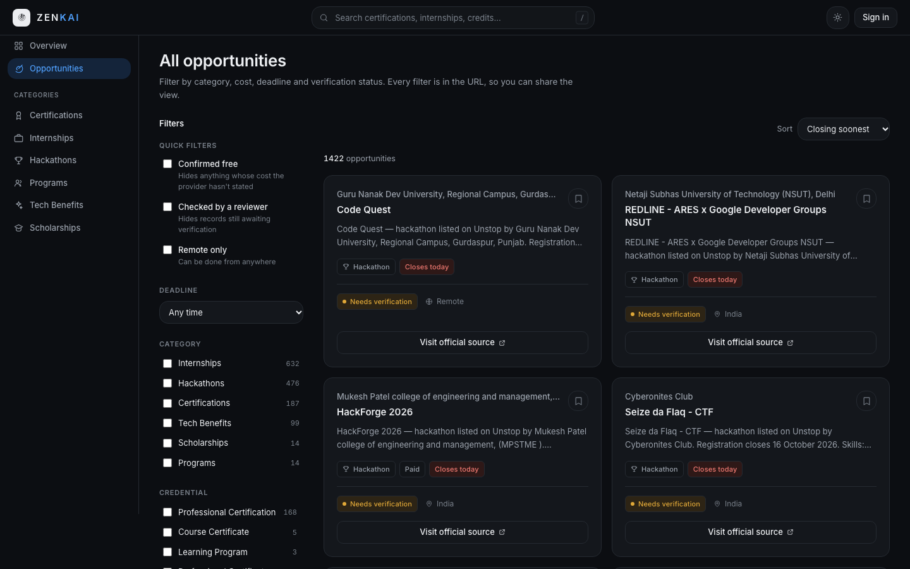

<div align="center">



<br />

**Internships, hackathons, certifications, scholarships, programs and free student tech — gathered from official sources, in one place, updated every 6 hours.**

<br />

[](https://getzenkai.vercel.app)
[](https://github.com/ganesh-tadigadapa/Zenkai/actions/workflows/discovery.yml)
[](https://github.com/ganesh-tadigadapa/Zenkai/actions/workflows/ci.yml)
[](LICENSE)


[**Live site**](https://getzenkai.vercel.app) ·
[What it is](#-what-is-zenkai) ·
[How it works](#%EF%B8%8F-how-it-works) ·
[How to use it](#-how-to-use-it) ·
[Tech stack](#%EF%B8%8F-tech-stack) ·
[Run locally](#-run-it-on-your-computer) ·
[Docs](#-documentation)

</div>

<br />

<p align="center">
  
</p>

---

## 🎯 What is Zenkai?

Good opportunities for students are spread over many websites: Devpost for hackathons, Unstop for internships, Microsoft Learn for certifications, GitHub for student offers, and many more. Nobody has time to check all of them, so students miss things that were free and open to them.

**Zenkai checks these websites for you, every 6 hours, automatically**, and puts everything in one simple feed.

<table>
  <tr>
    <td align="center" width="33%">💼<br /><b>Internships</b><br /><sub>Paid and unpaid, linked to the company's own application page</sub></td>
    <td align="center" width="33%">🏆<br /><b>Hackathons & Competitions</b><br /><sub>Online and in person, with real registration deadlines</sub></td>
    <td align="center" width="33%">📜<br /><b>Certifications</b><br /><sub>Courses and exams that give you a certificate</sub></td>
  </tr>
  <tr>
    <td align="center">✨<br /><b>Tech Benefits</b><br /><sub>Free software, cloud credits and tools for students</sub></td>
    <td align="center">👥<br /><b>Programs & Fellowships</b><br /><sub>Cohorts, ambassador programs and fellowships</sub></td>
    <td align="center">🎓<br /><b>Scholarships</b><br /><sub>Money for studies, travel and research</sub></td>
  </tr>
</table>

---

## ⚙️ How it works



1. **📥 It fetches.** Every 6 hours, Zenkai reads official sources: Devpost, MLH, Unstop (internships, hackathons, competitions and scholarships), SimplifyJobs, Microsoft Learn (certifications and Applied Skills), the GitHub Student Pack, Outreachy, Google Developers and Opportunity Desk. It also reads two community-maintained GitHub lists, of free certifications and of student developer discounts. Records from those stay marked **"Needs verification"** and link to each provider's own page.
2. **🧹 It cleans up.** If the same opportunity appears on two sites, it's kept only once. Posts that aren't real opportunities (news, product updates) are filtered out.
3. **🔄 It keeps things fresh:**
   - New listings are added.
   - If a deadline changes, the record is updated.
   - When a deadline passes, or a listing is removed from its source, it disappears from Zenkai.
4. **🎯 It ranks for you.** If you add your degree, skills and interests, every opportunity gets a match score, with a clear reason for every point.

---

## 🧭 How to use it

<p align="center">
  
</p>

| | Signed out | Guest | Free account |
|---|:---:|:---:|:---:|
| 🔍 Search and filter every opportunity | ✅ | ✅ | ✅ |
| 🔗 Go straight to the official page to apply | ✅ | ✅ | ✅ |
| 🏠 **Overview:** personal home page with recommendations | | ✅ | ✅ |
| 🔖 **Save** opportunities you like | | ✅ | ✅ |
| ⏰ **Deadlines:** what's closing today, this week and later | | ✅ | ✅ |
| 🎯 **Profile:** add your degree, skills and interests for better matches | | ✅ | ✅ |
| 📱 Sign in from any device | | | ✅ |

**Quick start:** open the [live site](https://getzenkai.vercel.app) → click **Get started**. You land in the app straight away on a guest account, with no email and no password → search something like *"AI hackathon"* or *"remote internship"* → filter by category, cost, deadline or remote → open one and apply on the official page.

**Keep your guest account:** on the **Profile** page, use **Save your account** to add your name, email and password. Everything you saved stays, and you can then sign in from any device.

> [!WARNING]
> A guest account exists only in the browser that started it. If you sign out before saving it with an email and password, it is gone.

Just want to look around? **Browse opportunities** works without any account.

> [!IMPORTANT]
> Always check the details on the official website before applying. Listings found automatically show **"Needs verification"** until a person reviews them.

---

## 💡 Why it's useful

- ⏱️ **Saves time:** one site instead of ten.
- 📅 **Never miss a deadline:** closing-soon listings are easy to see.
- 💸 **Free things are easy to find:** filter for "Free" or "Free for students".
- 🔍 **Honest:** every listing shows where it came from. Deadlines and costs are shown only when the source states them, never guessed.
- 🤝 **Respects websites:** Zenkai follows each site's robots.txt rules and never fetches from sites that don't allow it.
- 🚪 **No sign-up wall:** one click and you're in. Add an email later only if you want to keep the account.

---

## 🔒 Security and privacy

- **Passwords** are hashed with Argon2id. The real password is never stored.
- **Sessions** are random tokens kept in an httpOnly cookie, so browser JavaScript can't read them. The database stores only a hash of each token, and signing out revokes it instantly.
- **Changing your password** signs out every other device.
- **Your preferences and saved list** are visible only to you, and are never shared with the organisations listed.

---

## 🛠️ Tech stack

<table>
  <tr>
    <th>🎨 Frontend</th>
    <th>⚡ Backend</th>
    <th>📡 Data fetching</th>
  </tr>
  <tr valign="top">
    <td>
      • Next.js 16 (App Router, Server Components, Server Actions)<br />
      • React 19<br />
      • TypeScript<br />
      • Tailwind CSS v4<br />
      • CSS-only animations, Instrument Serif accents
    </td>
    <td>
      • Python 3.11<br />
      • FastAPI (REST API, docs at <code>/docs</code>)<br />
      • SQLAlchemy 2.0 and Pydantic v2<br />
      • PostgreSQL (SQLite for local development)<br />
      • Argon2 password hashing, secure sessions<br />
      • One-click guest accounts that can be upgraded later
    </td>
    <td>
      • httpx, with a polite fetcher: checks robots.txt, rate-limits each site, retries once on network errors<br />
      • Readers for APIs (Devpost, Unstop, Microsoft Learn, SimplifyJobs), web pages (MLH, GitHub Student Pack), community Markdown lists and RSS/Atom feeds
    </td>
  </tr>
</table>

**☁️ Hosting: all free plans**

| Part | Where it runs |
|---|---|
| 💻 Website | [Vercel](https://vercel.com) |
| ⚡ API | [Render](https://render.com) |
| 🗄️ Database | [Neon](https://neon.tech) PostgreSQL |
| 🔄 Fetching every 6 hours | GitHub Actions |
| 🔔 Keep-awake ping every 10 minutes | GitHub Actions |

**🧪 Testing:** 365 backend tests with pytest, plus TypeScript and ESLint checks. All of them run on every push through GitHub Actions.

---

## 🚀 Run it on your computer

You need **Python 3.11+** and **Node 20+**.

```bash
# 1. Install everything
make install

# 2. Create the database and add starting data
make seed

# 3. Start the backend (port 8000), and keep this running
make backend

# 4. In a new terminal, start the website (port 3000)
make frontend

# 5. (Optional) Fetch live opportunities now
make discover
```

Open **http://localhost:3000**. The API docs are at **http://localhost:8000/docs**.

> [!NOTE]
> `make backend` restarts the API by itself when you change backend code. If you start uvicorn some other way, add `--reload`. Without it, new API routes stay missing until you restart, and buttons that use them (such as **Get started**) fail with a 404.

```bash
make test    # backend tests
make lint    # frontend type check and lint
```

> [!TIP]
> Settings go in `backend/.env` and `frontend/.env.local`. Copy them from `.env.example`. Never upload real `.env` files.

<details>
<summary><b>📁 Project structure</b> (click to open)</summary>

```
ZENKAI/
├── frontend/
│   └── src/
│       ├── app/           # pages: landing, opportunities, dashboard, profile…
│       ├── components/    # UI pieces: cards, filters, intro, layout
│       └── lib/           # API client, server actions, session cookie
├── backend/
│   ├── app/
│   │   ├── api/           # API routes
│   │   ├── ingestion/     # fetching, cleaning and updating opportunities
│   │   ├── models/        # database tables
│   │   ├── services/      # matching, deadlines, accounts
│   │   └── seed/          # starting data and the list of sources
│   ├── tests/
│   └── run_discovery.py   # runs one fetch cycle
├── .github/workflows/     # tests, 6-hour fetch and keep-awake jobs
├── docs/                  # banner and screenshots
└── render.yaml            # Render deployment setup
```

</details>

---

## 📚 Documentation

| Document | What's inside |
|---|---|
| [ARCHITECTURE.md](docs/ARCHITECTURE.md) | Design decisions and the discovery pipeline in depth |
| [DATABASE.md](docs/DATABASE.md) | Every table and column |
| [DEVELOPMENT.md](docs/DEVELOPMENT.md) | Working on the code day to day |
| [DEPLOYMENT.md](docs/DEPLOYMENT.md) | Putting it on Vercel, Render and Neon |

---

## 🗺️ What's next

- [ ] 🔑 Password reset by email
- [ ] 🔐 Sign in with Google or GitHub
- [ ] 📧 Email alerts for new matches and deadlines
- [ ] 🎓 More scholarship sources
- [ ] 🧩 A Chrome extension

---

## 📄 License

This project is licensed under the [MIT License](LICENSE).

Opportunity listings shown on the site belong to their original sources (Devpost, Unstop, MLH, Microsoft Learn and others) and are subject to their terms.

<div align="center">

<br />

**If Zenkai helps you find something, give it a ⭐**

<sub>Built by <a href="https://github.com/ganesh-tadigadapa">Ganesh Tadigadapa</a></sub>

</div>
